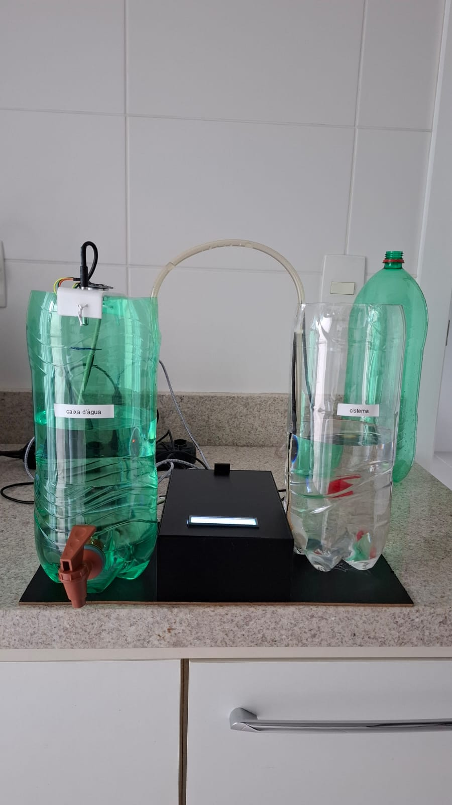
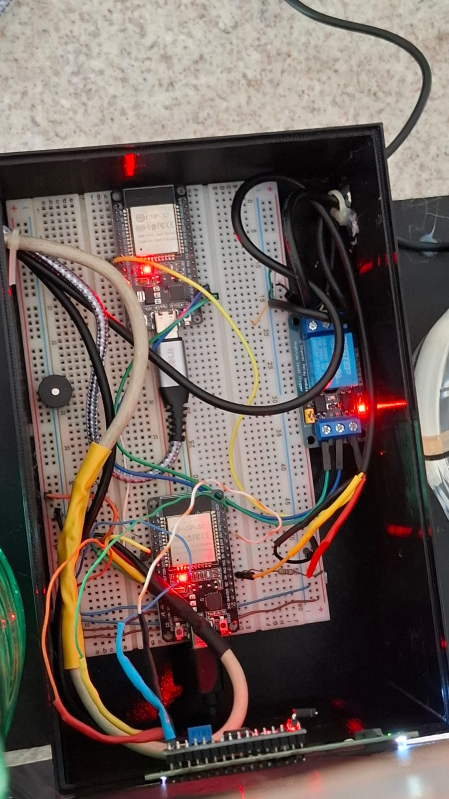

# Mapa de pinos (montagem da N3)

Como as placas estão montadas para a defesa: dois ESP32 numa protoboard dentro
de uma caixa, cada um com seu carregador USB, e a bomba com carregador
próprio. Só o medidor usa as linhas + e − da protoboard; o controlador é ligado
direto ao módulo relé. Onde a montagem difere do projeto do CP12, ver a seção
"Diferenças em relação ao CP12" no fim.

| Maquete | Dentro da caixa |
|---|---|
|  |  |

## ESP32 medidor (rsv-medidor-01)

| Pino ESP32 | Ligado a | Função | Observação |
|---|---|---|---|
| VIN (5 V) | Linha + da protoboard: HC-SR04, LCD | Alimentação | Vem do carregador USB do medidor |
| 3V3 | DS18B20 e o pull-up de 4,7 kΩ | Alimentação 3,3 V | Só cargas leves (cerca de 2 mA) |
| GND | Linha − da protoboard: todos os módulos do medidor | Terra comum | |
| GPIO33 | HC-SR04 TRIG | Saída, pulso de 10 µs | Mesmo pino da N1 |
| GPIO34 | HC-SR04 ECHO via divisor de dois resistores de 1 kΩ (ECHO, 1 kΩ, GPIO34, 1 kΩ, GND) | Entrada digital | Só entrada; recebe 2,5 V com o ECHO em 5 V |
| GPIO4 | DS18B20 DQ (fio de dados) | 1-Wire | Pull-up de 4,7 kΩ para 3,3 V |
| GPIO21 | SDA do módulo I2C do LCD (PCF8574) | I2C SDA | Ligado direto, fio curto; I2C a 50 kHz no firmware |
| GPIO22 | SCL do módulo I2C do LCD | I2C SCL | Ligado direto, fio curto |
| GPIO27 | + do buzzer (o − no GND) | Saída do buzzer | Ligado direto; tocado por PWM de 2,7 kHz |

## ESP32 controlador (rsv-controlador-01)

| Pino ESP32 | Ligado a | Função | Observação |
|---|---|---|---|
| USB | Carregador USB 5 V próprio | Alimentação | Separada da do medidor e da bomba; o controlador não usa as linhas da protoboard |
| 3V3 | DC+ do módulo relé JQC3F-03VDC | Bobina do relé (3 V) | Cerca de 120 mA com o relé acionado, tirados do regulador de 3,3 V da placa |
| GND | DC- do módulo relé | Terra do circuito lógico | Não vai ao terra do carregador da bomba |
| GPIO26 | In1 do módulo relé (jumper em High) | ALTO = bomba ligada | Sem resistor de pull-down: o firmware põe o GPIO26 em LOW antes de qualquer outra coisa no boot |
| COM / NO do relé | Carregador da bomba → bomba | Contato seco | A bomba tem carregador próprio, separado dos ESP32 |

O estado do controlador (modo, bomba, motivo do SEGURO) aparece no painel e no
Telegram. O firmware ainda aciona os pinos GPIO25 e GPIO27 do controlador para
LEDs de status (verde operando, vermelho em SEGURO), mas eles não foram
montados: dentro da caixa fechada não seriam vistos.

## Regras seguidas

- Nenhum GPIO de 6 a 11 e nenhum pino de strapping (0, 2, 5, 12, 15).
- Nenhuma carga de potência por GPIO: a bomba é chaveada pelo contato do relé,
  com alimentação própria; a bobina do relé é acionada pelo transistor do módulo.
- Sem sensores analógicos (HC-SR04 e DS18B20 são digitais).

## Diferenças em relação ao CP12

| Previsto no CP12 | Montado | Por quê |
|---|---|---|
| Relé de 5 V no VIN | Relé JQC3F-03VDC (bobina de 3 V) no 3V3, jumper em High | Modelo disponível; aciona com o nível de 3,3 V do ESP32 |
| Divisor do ECHO com 1 kΩ e 2 kΩ (3,33 V no GPIO34) | Divisor com 1 kΩ e 1 kΩ, o mesmo da N1 (2,5 V no GPIO34) | Funciona nos testes, mas com pouca folga sobre o mínimo de 2,48 V para nível alto; a melhoria é pôr mais 1 kΩ em série no resistor de baixo |
| Conversor de nível BSS138 no I2C do LCD | SDA e SCL ligados direto | Funciona com os pull-ups do módulo; o firmware reduz o I2C para 50 kHz |
| Buzzer por transistor BC547 | Buzzer direto no GPIO27 | Buzzer de baixa corrente, toca direto do pino |
| LEDs de status verde e vermelho | Não montados | Ficariam escondidos na caixa; o estado está no painel e no Telegram |
| Diodo 1N4007, capacitores e fusível na bomba | Não montados | O ruído do motor embaralhava o LCD; resolvido encurtando os fios do LCD e afastando-os dos fios da bomba e do relé. O firmware também realinha o LCD a cada 3 s como garantia. O diodo e o capacitor de 100 nF nos terminais da bomba continuam recomendados |
| Placas perfuradas e duas caixas | Uma protoboard numa caixa, com os fios do LCD soldados | Montagem possível no prazo |
| Fonte B de 5 V / 2 A para a bomba | Carregador USB próprio da bomba | Mesmo papel: alimentação separada dos ESP32 |
