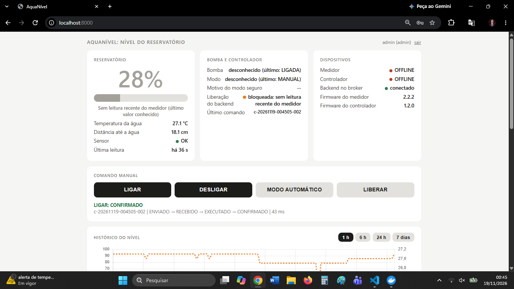
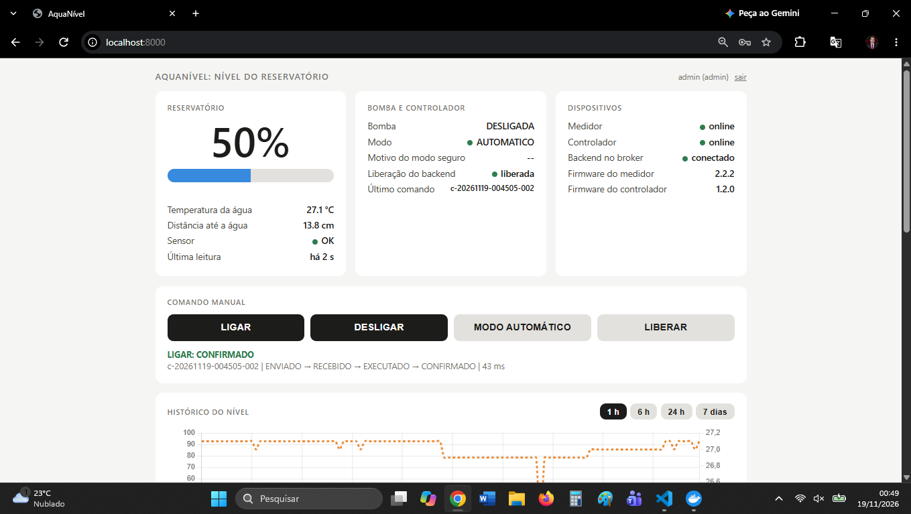
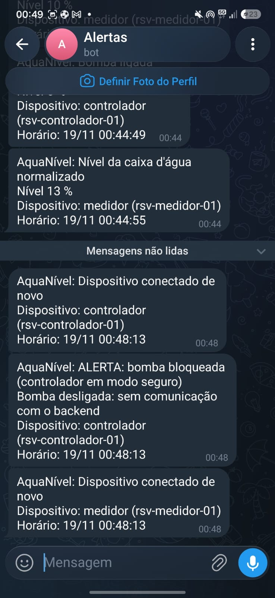
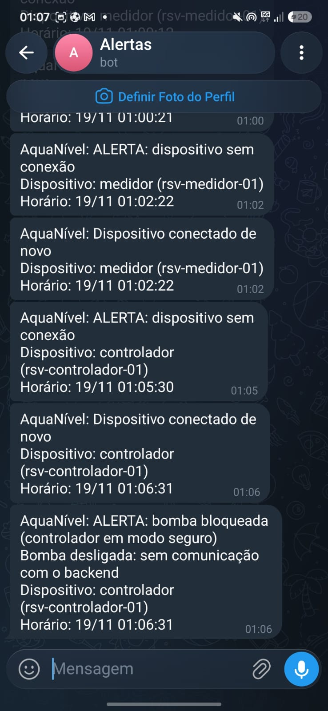
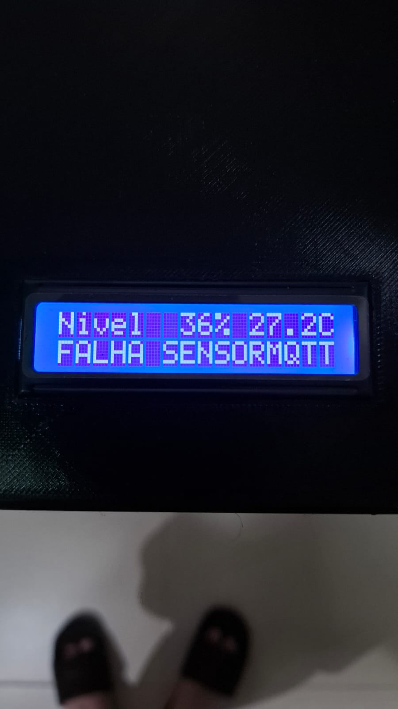
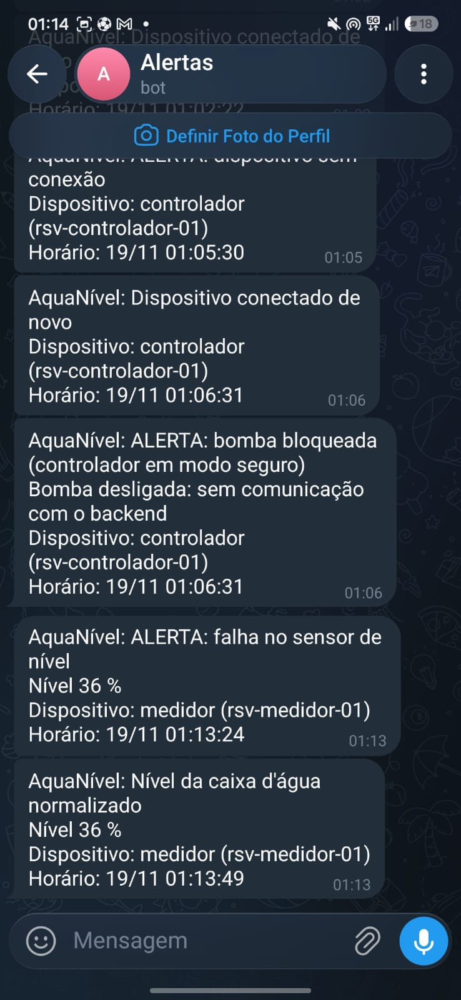
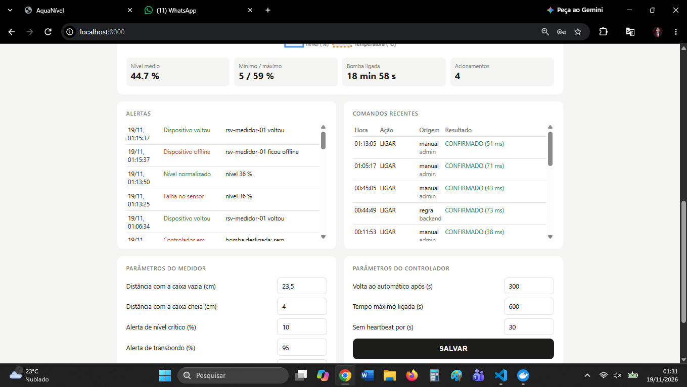
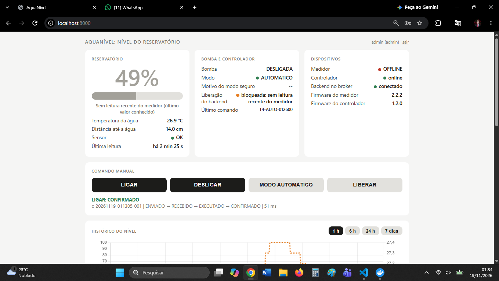

# Testes de falha (R10)

Placas reais na tomada, notebook no hotspot do celular rodando o compose
(broker com TLS, backend e banco) e o `anunciar_broker.py`. Firmwares:
medidor 2.2.2, controlador 1.2.0. Horários de Brasília. As evidências vêm do
banco do backend (tabelas `conexoes`, `estado`, `alertas`, `medicoes`,
`comandos`), dos alertas no Telegram, de prints do painel e de fotos.

## Teste 1: queda do Wi-Fi (19/11/2026)

**Como foi provocado.** Com a bomba ligada pelo painel (LIGAR manual às
00:45:05, nível 28 % e subindo), o hotspot do celular foi desligado e religado
cerca de 3 minutos depois. As duas placas e o notebook ficaram sem rede.

**Comportamento esperado.**
- Controlador: sem heartbeat do backend, desligar a bomba em até 30 s e entrar
  em SEGURO (SEM_HEARTBEAT).
- Medidor: continuar medindo e mostrando no LCD, com `----` no lugar de `MQTT`.
- Na volta: as placas reconectam sozinhas; o controlador sai do SEGURO depois de
  3 heartbeats válidos; os alertas chegam ao Telegram.

**Comportamento observado.**

| Hora | Evento | Fonte |
|---|---|---|
| 00:45:05 | LIGAR manual: ENVIADO, RECEBIDO, EXECUTADO, CONFIRMADO em 43 ms | painel, `comandos` |
| 00:45:24 | broker registra as duas placas OFFLINE (Last Will) | `conexoes`, `alertas` |
| depois | bomba segue ligada até o fim do timeout de heartbeat e para sozinha; o nível sobe de 28 % para 50 % nesse intervalo | observação, painel |
| durante | LCD do medidor mostra `----` no lugar de `MQTT` e continua medindo | observação |
| 00:48:13 | as duas placas reconectam sozinhas; o controlador volta com o estado `SEGURO / SEM_HEARTBEAT`, bomba DESLIGADA | `conexoes`, `estado` |
| 00:48:34 | controlador sai do SEGURO para AUTOMATICO depois de 3 heartbeats (21 s) | `estado` |
| 00:48:13 | Telegram: controlador e medidor conectados de novo e "bomba bloqueada: sem comunicação com o backend" | Telegram |

**Resultado: atendido.** A bomba desligou sozinha sem rede, nada travou e a
recuperação foi automática, sem reiniciar nenhuma placa.

**Evidências.**

| Durante a queda (00:45) | Na volta, em SEGURO (00:48) | Recuperado (00:49) |
|---|---|---|
|  |  |  |

Telegram na volta da rede (00:48:13): placas conectadas de novo e bomba bloqueada por falta de comunicação.



**Problema encontrado e corrigido.** Os avisos de OFFLINE (00:45:24) não
chegaram ao Telegram: o notebook também estava sem internet, e o backend
descartava o alerta na primeira falha de envio. Corrigido em
`backend/app/telegram.py`: o alerta fica na fila e é reenviado (5, 10, 20, 40,
60 s...) até a rede voltar, por até 30 minutos, mantendo o horário do evento e a
ordem. Na mesma revisão, o log do httpx deixou de registrar a URL da Bot API,
que continha o token do bot.

## Teste 2: broker indisponível (19/11/2026)

**Como foi provocado.** Com a bomba ligada em MANUAL (nível 30 %), o broker foi
parado com `docker compose stop mosquitto` às 01:05:29 e religado com
`docker compose start mosquitto` às 01:06:21 (52 s fora do ar). Wi-Fi e
internet continuaram normais.

**Comportamento esperado.**
- Controlador: sem heartbeat, desligar a bomba em até 30 s e entrar em SEGURO
  (SEM_HEARTBEAT).
- Medidor: continuar medindo, com `WIFI` no LCD no lugar de `MQTT`.
- Backend: não cair; tentar reconectar sozinho.
- Na volta: tudo reconecta sem intervenção.

**Comportamento observado.**

| Hora | Evento | Fonte |
|---|---|---|
| 01:05:17 | bomba LIGADA em MANUAL | `estado` |
| 01:05:29 | broker parado | comando |
| 01:05:30 | backend perde a conexão e passa a tentar de novo a cada 3 s, sem cair | log do backend |
| 01:05:31 | Telegram: "dispositivo sem conexão" (controlador) | log, Telegram |
| 01:05:30 | LCD do medidor troca `MQTT` por `WIFI` (nível em 37 %) e segue medindo | observação |
| até 30 s depois | bomba para sozinha, com o nível em 59 % (timeout do heartbeat) | observação, painel |
| 01:06:21 | broker religado | comando |
| 01:06:26 | backend reconectado ao broker (TLS) | log do backend |
| 01:06:31 | controlador ONLINE, com o estado `SEGURO / SEM_HEARTBEAT`, bomba DESLIGADA | `conexoes`, `estado` |
| 01:06:34 | medidor ONLINE, telemetria normal | `conexoes`, `medicoes` |
| 01:06:54 | controlador volta ao AUTOMATICO depois de 3 heartbeats | `estado` |
| 01:05:30 a 01:06:31 | Telegram: controlador sem conexão, conectado de novo e "bomba bloqueada: sem comunicação com o backend" | Telegram |

**Resultado: atendido.** A bomba desligou sem o broker, o backend sobreviveu à
queda e tudo voltou sozinho em 33 s depois que o broker voltou.

**Evidência.** Telegram: controlador sem conexão (01:05:30), conectado de novo e
bomba bloqueada (01:06:31). As duas mensagens de 01:02:22 no topo são da queda
do medidor descrita no fim deste documento, não deste teste.



**Problema encontrado e corrigido.** O "medidor offline" não foi gravado nem
avisado. Com o broker parando, o backend recebeu o Last Will do medidor e tentou
publicar o heartbeat de bloqueio pelo próprio broker que estava caindo; a falha
da publicação interrompeu o resto do tratamento (gravar a conexão e o alerta).
Corrigido em `backend/app/ponte.py`: falha ao publicar heartbeat, comando ou
configuração não interrompe mais o registro, e comando ou configuração sem
broker respondem "sem conexão" na API. Dois testes novos reproduzem o caso.

## Teste 3: falha de sensor (19/11/2026)

**Como foi provocado.** Com a bomba ligada em MANUAL (LIGAR às 01:13:05), os
fios ECHO e GND do HC-SR04 foram soltos e encaixados de volta cerca de 25 s
depois.

**Comportamento esperado.**
- Medidor: depois de 3 s de leituras inválidas seguidas, marcar SENSOR_FALHA:
  LCD mostra `FALHA SENSOR`, buzzer bipa a cada 3 s, telemetria sai com
  `sensor: FALHA` e o alerta é publicado.
- Backend: tirar a liberação da bomba (`liberaBomba=false`, SEM_LEITURA); o
  controlador desliga a bomba; LIGAR passa a ser rejeitado.
- Na volta: alerta NORMALIZADO e liberação de novo.

**Comportamento observado.**

| Hora | Evento | Fonte |
|---|---|---|
| 01:13:05 | LIGAR manual, CONFIRMADO; bomba LIGADA | `comandos`, `estado` |
| 01:13:24 | medidor publica SENSOR_FALHA (nível 36 %); telemetria passa a sair com `sensor: FALHA` a cada 3 s | `alertas`, `medicoes` |
| 01:13:24,996 | backend publica heartbeat `liberaBomba=false (SEM_LEITURA)` | log do backend |
| 01:13:25 | controlador desliga a bomba (0,2 s depois da falha chegar) | `estado` |
| 01:13:26 | Telegram: "ALERTA: falha no sensor de nível" | log, Telegram |
| durante | LCD mostra `FALHA SENSOR` e o buzzer bipa | observação, foto |
| 01:13:49 | fios recolocados: alerta NORMALIZADO; liberação volta (`liberaBomba=true`) | `alertas`, log |
| 01:13:50 | telemetria volta a `sensor: OK`; Telegram: "nível normalizado" | `medicoes`, Telegram |

**Resultado: atendido.** A falha foi detectada no próprio medidor (regra local:
LCD e buzzer) e no backend, que bloqueou a bomba em 0,2 s; a recuperação foi
automática ao recolocar os fios.

**Evidências.**

| LCD do medidor durante a falha | Telegram |
|---|---|
|  |  |

No painel, a lista de alertas registra "Falha no sensor" (01:13:25) e "Nível
normalizado" (01:13:50), e a de comandos mostra o LIGAR manual de 01:13:05
CONFIRMADO em 51 ms.



## Teste 4: comando inválido e duplicado (19/11/2026)

**Como foi provocado.** Mensagens montadas à mão e publicadas direto no broker
com `mosquitto_pub` (dentro do contêiner do broker, com TLS), já que o painel só
gera comandos válidos e com ID novo. Comandos com o usuário `backend` (o único
que a ACL deixa publicar em `cmd`); telemetrias com o usuário `rsv-medidor-01`.
Nível em 40 %, controlador em AUTOMATICO.

| # | Mensagem | Esperado |
|---|---|---|
| 1 | LIGAR com `commandId` T4-DUP-012546 | executar |
| 2 | o mesmo LIGAR, mesmo `commandId` (reentrega do QoS 1) | REJEITADO `COMANDO_DUPLICADO`, sem executar de novo |
| 3 | DESLIGAR | executar |
| 4 | `acao` = `EXPLODIR` | REJEITADO `COMANDO_DESCONHECIDO` |
| 5 | telemetria com JSON cortado | backend descarta e registra `PAYLOAD_INVALIDO` |
| 6 | telemetria com `v=2` | backend descarta e registra `VERSAO_INCOMPATIVEL` |
| 7 | MODO_AUTO | volta ao AUTOMATICO |

**Comportamento observado.**

| Hora | Evento | Fonte |
|---|---|---|
| 01:25:47 | T4-DUP-012546: RECEBIDO e EXECUTADO; bomba LIGADA (MANUAL) | `acks`, `estado` |
| 01:25:51 | T4-DUP-012546 de novo: REJEITADO `COMANDO_DUPLICADO`; nenhum estado novo, a bomba não foi acionada outra vez | `acks`, `estado` |
| 01:25:55 | DESLIGAR: RECEBIDO e EXECUTADO; bomba DESLIGADA | `acks`, `estado` |
| 01:25:57 | `EXPLODIR`: REJEITADO `COMANDO_DESCONHECIDO` | `acks` |
| 01:25:59 | JSON cortado: `PAYLOAD_INVALIDO` ("Expecting value: line 1 column 44") | `payloads_invalidos` |
| 01:25:59 | `v=2`: `VERSAO_INCOMPATIVEL` | `payloads_invalidos` |
| 01:26:00 | MODO_AUTO: EXECUTADO; controlador em AUTOMATICO | `acks`, `estado` |
| 01:26:19 | backend no ar e conectado ao broker | `/api/saude` |

**Resultado: atendido.** O controlador rejeitou o comando duplicado e o
desconhecido com o motivo, sem executar; o backend descartou e registrou as
mensagens inválidas e continuou funcionando.

**Pelo painel** dá para mostrar também comandos proibidos com motivo (R7):
LIGAR com nível em 90 % ou mais é rejeitado com `NIVEL_ALTO`, e LIGAR com o
controlador em SEGURO, com `MODO_SEGURO`.

## Como repetir o teste 4

Na pasta do projeto (as senhas vêm do ambiente do contêiner do broker):

```
docker exec aquanivel-mqtt sh -c '
P=catolicasc-g4/reservatorio; B="-h localhost -p 8883 --cafile /certs/ca.crt -u backend -P $MQTT_SENHA_BACKEND"
TS=$(date -u +%Y-%m-%dT%H:%M:%SZ)
CMD="{\"v\":1,\"commandId\":\"T4-DUP\",\"origem\":\"manual\",\"acao\":\"LIGAR\",\"usuario\":\"teste\",\"ts\":\"$TS\"}"
mosquitto_pub $B -q 1 -t $P/rsv-controlador-01/cmd -m "$CMD"
sleep 3
mosquitto_pub $B -q 1 -t $P/rsv-controlador-01/cmd -m "$CMD"'
```

Como esses comandos não foram criados pelo backend, eles não aparecem em
"Comandos recentes" no painel: a rejeição fica na tabela `acks` e no log do
backend (`ack T4-DUP: REJEITADO motivo=COMANDO_DUPLICADO`). Para repetir na
mesma sessão do controlador, troque o `commandId`, porque ele lembra os últimos
8 IDs; depois de LIGAR, mande DESLIGAR ou use o painel.

## Observação: quedas do medidor sem falha provocada

Entre 00:55 e 01:35 de 19/11, sem nenhum teste em andamento, o broker
desconectou o medidor algumas vezes por "exceeded timeout" (mais de 22 s sem
receber nada dele, com telemetria configurada a cada 3 s). A sequência da
telemetria mostrou mensagens perdidas e outras chegando em rajada, e às 01:32 o
medidor levou cerca de 2 minutos e meio para reconectar, sem reiniciar.

Durante a queda o sistema se comportou como projetado: o painel marcou o medidor
OFFLINE e o nível em cinza como último valor conhecido, e o backend bloqueou a
bomba por falta de leitura (`SEM_LEITURA`).



Causa provável: o celular que fazia o hotspot estava com 14 a 23 % de bateria,
com a economia de energia reduzindo o desempenho do Wi-Fi. O controlador, que
manda bem menos mensagens, não foi afetado. Para a defesa: hotspot carregando,
perto da caixa e sem economia de bateria (ou roteador dedicado, como previsto
nos riscos do CP12).
